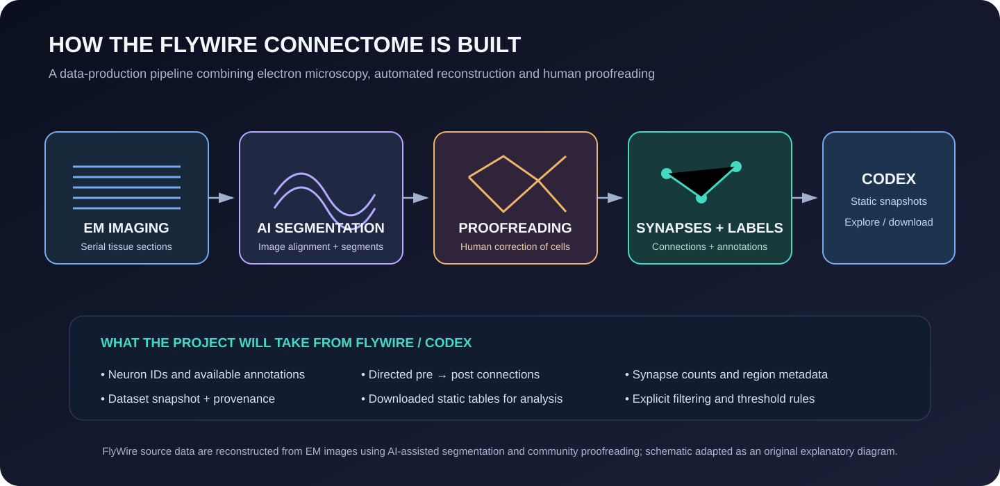
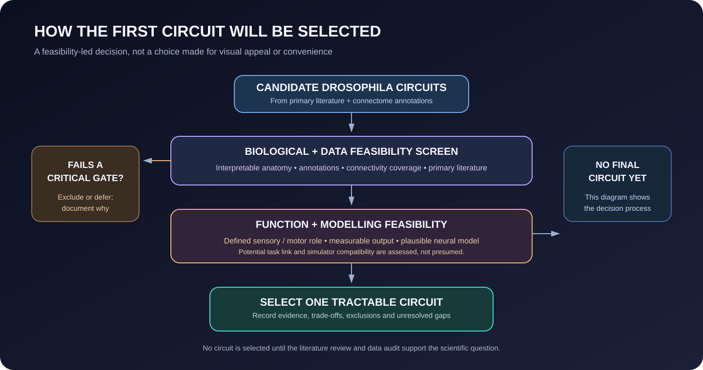

# Dataset and Circuit Selection

**Status:** Candidate assessment. No final circuit or dataset snapshot has been selected.

## Candidate resources

### FlyWire / Codex

Candidate resource for adult Drosophila brain connectivity and annotations.

- Entry point: https://codex.flywire.ai/
- Project context: https://flywire.ai/
- Candidate snapshot: FAFB v783 (October 2023; listed by the Codex FAQ as the available/latest FAFB release at the time of review).

- Codex dataset page: https://codex.flywire.ai/
- Current snapshot metadata: https://codex.flywire.ai/faq

Codex currently lists 139,255 neurons and 3,732,460 connections for FAFB v783 on its dataset overview. Treat these as release-level overview counts; the exact edge table, synapse thresholds and filtering used in this project must be recorded separately.

### BANC

Candidate brain-and-nerve-cord connectome resource.

- Candidate snapshot: BANC v888 (May 20, 2026; listed by the Codex FAQ as the available/latest BANC release at the time of review).

- Codex dataset page: https://codex.flywire.ai/
- Current snapshot metadata: https://codex.flywire.ai/faq

Codex currently lists 158,262 neurons and 3,037,361 connections for BANC v888 on its dataset overview. Treat these as release-level overview counts; the exact edge table, synapse thresholds and filtering used in this project must be recorded separately.
- Verify the exact release, data access route, annotation coverage and licence at project start.

### Published circuit-specific data

Published datasets and supplementary materials may be preferable if they provide:
- Clear circuit boundaries.
- Functional or physiological context.
- A defined behavioural link.
- Reusable neuron and connection annotations.

## FlyWire data-generation and access pathway

The FlyWire reconstruction workflow combines:
1. Serial electron-microscopy imaging of brain tissue.
2. Alignment and AI-assisted segmentation of neuronal structures.
3. Community proofreading and correction of reconstructions.
4. Synapse prediction and associated annotations.
5. Consolidated snapshot publication through Codex for analysis and exploration.

CAVE supports live proofreading and database-backed workflows; Codex provides static, consolidated snapshots for analysis. For bulk programmatic analysis, use the official Codex download products rather than scraping interactive pages or issuing repeated app queries.

## Circuit-selection scorecard

Score each candidate from 1 (weak) to 5 (strong), with evidence and notes.

| Criterion | Score | Evidence / notes |
|---|---:|---|
| Biological interpretability | TBD | Primary literature |
| Connectivity completeness | TBD | Dataset audit |
| Neuron-type annotations | TBD | Annotation coverage |
| Functional evidence | TBD | Physiology and perturbation literature |
| Behavioural link | TBD | Defined task and relevant pathways |
| Input/output feasibility | TBD | Model design |
| Embodiment compatibility | TBD | Simulator interface |
| Computational tractability | TBD | Pilot benchmark |
| Reproducibility/access | TBD | API, versioning and terms |

Do not select a circuit based on total score alone. Critical gaps in functional evidence or input/output mapping may disqualify a candidate even if its numerical score is high.

## Dataset decision checklist

- [ ] Confirm current dataset release and snapshot identifier.
- [ ] Read data-use terms and attribution requirements.
- [ ] Confirm access method and API stability.
- [ ] Inspect available neuron annotations.
- [ ] Inspect connection attributes and their definitions.
- [ ] Quantify coverage and missingness.
- [ ] Determine whether required cell types and pathways are represented.
- [ ] Record coordinate systems and identifiers.
- [ ] Run a small retrieval and processing pilot.
- [ ] Freeze selected source and version in configuration.

## Data provenance schema

Each dataset manifest should include:
- Resource name and URL.
- Citation.
- Snapshot/version.
- Retrieval date.
- Query or download procedure.
- Inclusion/exclusion rules.
- Counts before and after filtering.
- Annotation fields used.
- Known limitations.
- Licence/access notes.
- Checksums where practical.

## Important interpretation rule

Anatomical synapse counts or edge counts are structural measurements. They are not automatically equivalent to synaptic conductance, efficacy, sign or physiological influence. Any transformation from structural data to model parameters must be justified and labelled.

**Layperson summary:** We have more than one possible source of fruit-fly brain wiring data. This file is where we compare them carefully and record exactly which version we use, what it contains and what its limitations are.
