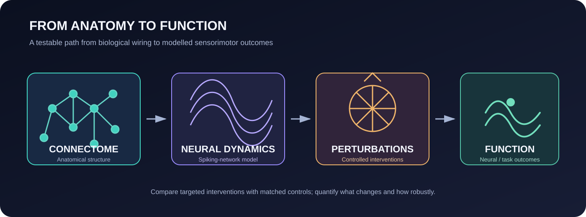
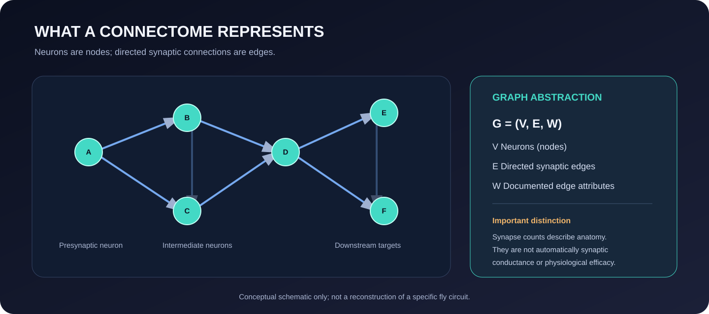
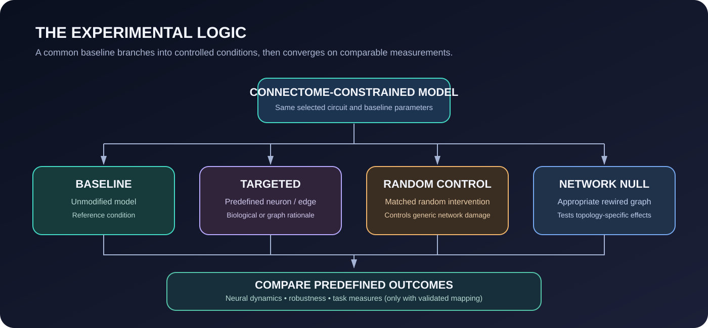
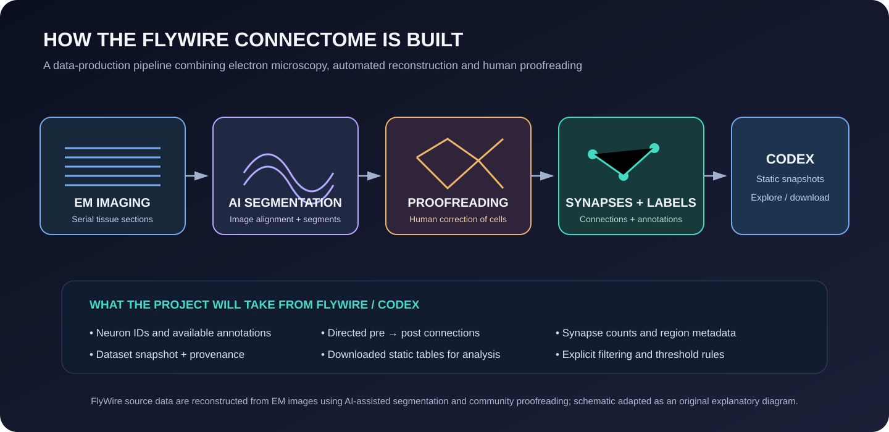
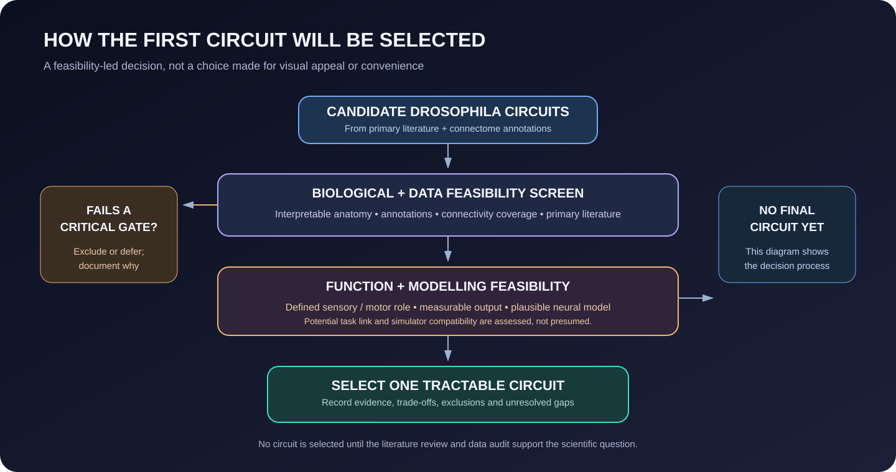
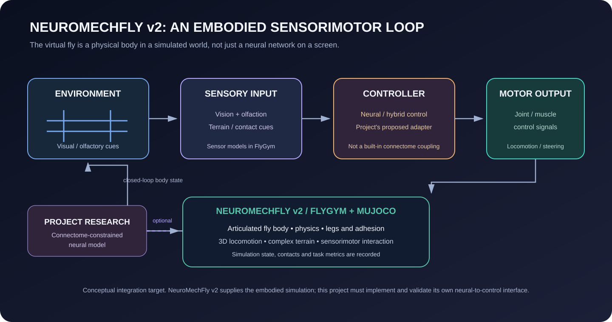
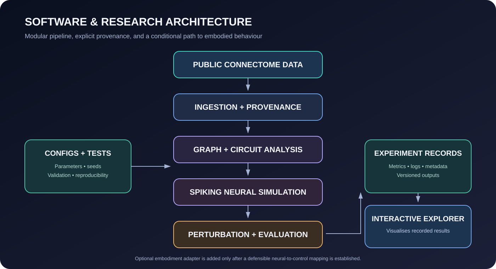

# From Connectome to Control
### How does the wiring of a neural circuit shape its dynamics, robustness, and sensorimotor function?

<div align="center">

[](PROJECT_PLAN.md)
[](RESEARCH_PROTOCOL.md)
[](pyproject.toml)
[](LICENSE)

**Researcher:** [Angelic Charles](https://github.com/visionbyangelic)  
**System:** *Drosophila melanogaster*  
**Research areas:** Connectomics · Computational neuroscience · Neural dynamics · Network robustness · Sensorimotor modelling

</div>

> **Project status:** This is an active research-design and feasibility project. The repository contains the scientific rationale, proposed hypotheses, protocol, architecture and initial software scaffold. The experiments, connectome extraction, neural simulations and embodied integration have not yet been completed. The diagrams below illustrate the proposed research design, not experimental findings.

---

## The project in plain English

A connectome is a map of which neurons are connected to which other neurons. But a wiring map is not the same thing as an explanation of how a nervous system works.

This project takes a small, biologically meaningful circuit from the fruit fly nervous system and asks what its wiring allows it to do. We will turn the connectome into a computational network, simulate how its neurons communicate, and then perform controlled virtual experiments by changing selected neurons, connections or inputs.

The central interest is not simply whether the model can produce activity. It is whether the organisation of the biological network makes a measurable difference to that activity, how well the network withstands disruption, and whether those changes matter for a defined sensorimotor task.

The first study will focus on one tractable circuit. A whole-brain simulation is not the starting point.

---

## 1. The research problem: a wiring diagram is not yet a functional explanation

Connectomics is making increasingly detailed maps of nervous-system structure available to researchers. These maps reveal anatomical relationships at a scale that was previously difficult to study. Yet several scientific steps remain between knowing that two neurons are connected and explaining what that connection contributes to the functioning of a circuit.

Three problems motivate this project:

1. **Structure does not directly specify dynamics.** Anatomical connectivity alone does not tell us when neurons fire, how activity propagates, or which patterns of activity are stable.
2. **The functional importance of connections is not obvious from a map.** A highly connected neuron is not automatically the most important neuron for a particular task. Its role depends on circuit context, cell identity, physiology and the inputs and outputs being studied.
3. **Robustness needs controlled comparison.** If a model changes after a neuron is removed, we need to know whether the effect is specific to that neuron or simply what would happen after removing any comparable amount of network structure.

This project addresses these gaps with a connectome-constrained neural model and a controlled perturbation framework. It will compare targeted interventions with appropriate random and network-null controls, while separating measured anatomical information from inferred model parameters.

> **In plain English:** Having a map of a city's roads does not tell us how traffic will flow, which roads matter most during a disruption, or whether the city can still function when one route closes. We want to investigate the equivalent questions for a neural circuit.

---

## 2. The central research question

<div align="center">

### How does the structural organisation of a biological neural circuit influence its functional robustness, and how do targeted disruptions to that circuit affect its ability to support sensorimotor behaviour?

</div>

The question connects four levels of explanation:

- **Anatomy:** What is connected, and how is the circuit organised?
- **Dynamics:** What patterns of neural activity emerge from the model?
- **Robustness:** Which properties of the network are preserved or disrupted when selected components are altered?
- **Function:** Do those changes affect a defined sensorimotor outcome, if a scientifically defensible neural-to-control mapping can be established?



*Figure 1. Proposed conceptual pathway. This is a research-design illustration, not a result.*

### What is the connectome, computationally?

A connectome is represented here as a directed network. A neuron is a node; a synaptic connection is a directed edge from a presynaptic neuron to a postsynaptic neuron. Edge attributes may include synapse count and neuropil/region metadata where supplied by the dataset.



*Figure 2. Connectome abstraction used by the project. This is an explanatory schematic, not a reconstruction of a selected biological circuit.*

> **In plain English:** We move from the physical wiring, to what the model does, to what happens when we change part of it, and finally to whether those changes affect a measurable task.

---

## 3. Testable hypotheses

These hypotheses define what the study will investigate. They are not findings, and their final operational definitions will be frozen only after the circuit and dataset feasibility review.

| Hypothesis | Scientific prediction | What would test it? |
|---|---|---|
| **H1 · Structural organisation** | The selected connectome-derived network will show measurable differences in neural dynamics or perturbation response compared with appropriately randomised networks. | Compare network measures and simulated activity with suitable null models. |
| **H2 · Targeted vulnerability** | Some biologically or structurally targeted interventions will produce larger changes in predefined functional measures than degree-matched random interventions. | Compare targeted neuron/edge perturbations with matched random controls. |
| **H3 · Circuit function** | Perturbing pathways relevant to the selected sensorimotor task will alter predefined task measures in the coupled model. | Test baseline and perturbed conditions after establishing a defensible neural-to-control mapping. |
| **H4 · Robustness of conclusions** | The main qualitative conclusions will not depend on one narrow set of model parameters or one hand-selected configuration. | Parameter sweeps, sensitivity analysis and recovery checks where applicable. |

A result that does not support a hypothesis is still a result. Null findings, unexpected effects, failed model assumptions and limits of the selected circuit will be documented.

> **In plain English:** We are not starting with the assumption that certain neurons must be important. We will make predictions, compare them with fair controls, and allow the data to disagree with us.

---

## 4. The experiment: from biological circuit to controlled virtual intervention

The study is designed as a sequence of linked stages.

### Stage A — Select and reconstruct a circuit

Identify a Drosophila circuit with suitable public connectivity data, interpretable annotations, relevant primary literature and a plausible connection to a defined input/output task. Build a versioned, directed graph while preserving source identifiers and data provenance.

### Stage B — Characterise its structure

Measure appropriate graph properties, such as in-degree and out-degree, weighted strength where justified, centrality, motifs, clustering, communities and reachability. Compare the biological network with appropriate null models, including degree-preserving randomisation where feasible.

### Stage C — Simulate neural dynamics

Build a tractable spiking neural network constrained by the selected circuit's connectivity. The initial candidate is a leaky integrate-and-fire (LIF) formulation. Specify the membrane and synaptic dynamics, input protocol, delays, numerical integration and parameter sources.

Anatomical synapse counts will **not** be treated automatically as physiological synaptic strengths. Any inferred weights or physiological parameters will be explicitly labelled as assumptions or calibrated quantities.

### Stage D — Perturb the model

Run controlled interventions, including:

- Neuron ablation or functional silencing.
- Synaptic weakening or enhancement.
- Changes to the magnitude, timing or pattern of input.
- Targeted interventions compared with matched random interventions.
- Network-null comparisons where the graph representation permits them.

### Stage E — Evaluate function

Measure neural outcomes in every valid model condition. Evaluate behaviour only if a documented neural-to-control mapping can be established for the selected task. FlyGym / NeuroMechFly v2 is a candidate later-stage environment, not a guaranteed component of the first study. NeuroMechFly v2 provides an embodied Drosophila model with a MuJoCo-based physics simulation, sensory capabilities including vision and olfaction, and support for complex terrain and sensorimotor control. The proposed connectome-constrained controller would need to be integrated through a separately implemented and validated neural-to-control adapter; this is not an automatic or built-in connection.



*Figure 3. Proposed experimental conditions and comparison logic.*

> **In plain English:** We first build a working model of one circuit. Then we run it normally and under carefully chosen disruptions. We compare those outcomes with random disruptions, so we can tell whether a particular part of the biological network has a distinctive effect.

---

## 5. What will be measured?

The exact primary outcomes will be selected and documented before confirmatory analysis, once the circuit and task are chosen.

### Neural outcomes

Potential measures include:

- Firing-rate distributions.
- Population activity and temporal response.
- Spike-train synchrony, using a specified statistic.
- Response latency.
- Persistence or stability of activity.
- Changes in network-level activity after perturbation.

### Behavioural outcomes, conditional on a valid interface

Potential measures include:

- Task success or target acquisition.
- Navigation or tracking error.
- Movement stability.
- Response latency.
- Recovery after perturbation.

A behavioural measure will only be used if the model has an explicit, documented mapping from circuit output to the relevant control variable. Neural activity alone will not be presented as evidence of behaviour.

### Controls and validation

- Multiple random seeds for stochastic experiments.
- Random interventions matched on relevant network properties.
- Appropriate network-null models.
- Baseline model checks and implementation tests.
- Separation of calibration and evaluation conditions.
- Parameter sensitivity analysis.
- Synthetic parameter-recovery tests where applicable.
- Effect sizes and uncertainty intervals.
- Multiple-comparison correction where appropriate.
- Predefined inclusion and exclusion criteria.
- Retention of failed runs and documented exclusion reasons.

> **In plain English:** We will decide what counts as a meaningful change before looking at the final results. We will repeat simulations, use comparison groups and check whether the findings survive reasonable changes to the model.

---

## 6. Biological system and dataset strategy

The initial biological system is the adult fruit fly, *Drosophila melanogaster*. The first study will use one selected circuit or subnetwork rather than attempting to model the entire nervous system.

### How FlyWire data are produced

FlyWire's connectome is built from serial electron-microscopy images. AI-assisted image analysis segments neuronal structures; community proofreading corrects and refines reconstructions. Synapse predictions and annotations are then combined into a connectome resource. Codex provides consolidated, versioned snapshots for exploration and analysis, while CAVE supports live proofreading and database-backed workflows.



*Figure 4. Simplified FlyWire data-production and access pathway. The diagram is an original explanation of the published workflow, not a screenshot of the platform.*

### Candidate connectome resources

| Resource | Why it is being considered | Current decision |
|---|---|---|
| [FlyWire / Codex](https://codex.flywire.ai/) | Adult fly brain connectivity, annotations and circuit exploration. | Candidate; snapshot and coverage require verification. |
| [BANC](https://flywire.ai/) | Brain-and-nerve-cord connectivity may support circuits with broader sensorimotor context. | Candidate; access, annotations and compatibility require verification. |
| Published circuit datasets and supplementary data | May provide clearer functional context for a specific circuit or task. | To be reviewed alongside the connectome resources. |

Dataset versions previously identified for feasibility checking (FlyWire/Codex version 783 and BANC version 888) are **candidate snapshots only**. They are not yet confirmed study datasets. Their availability, current identifiers, annotation schemes, licensing and suitability must be checked before selection. The project will not merge resources simply because they are available.

### Circuit-selection criteria

The selected circuit must be defensible against the following criteria:

1. Biological interpretability and relevant primary literature.
2. Completeness and confidence of connectivity data.
3. Availability of neuron-type and neurotransmitter annotations.
4. Evidence connecting the circuit to sensory processing, motor output or a defined behaviour.
5. Feasibility of a defensible input/output model.
6. Compatibility with available simulation interfaces.
7. Computational cost and reproducibility.

Every derived dataset will retain its source, snapshot identifier, retrieval date, filtering rules, inclusion/exclusion counts, annotation missingness, transformation history and software versions.




*Figure 5. Circuit selection is a gated decision. A critical weakness in functional evidence or a defensible input/output mapping can outweigh a high score elsewhere.*
> **In plain English:** We will choose the circuit based on the quality of its data and how much scientists already know about its function. The dataset choice is a research decision, not just a technical convenience.

---

## 7. Neural model: how anatomy becomes dynamics

The initial candidate is a leaky integrate-and-fire model. For neuron \(i\), a standard membrane formulation is:

\[
\tau_m \frac{dV_i}{dt}
= -(V_i - V_{\mathrm{rest}}) + R_m I_i(t)
\]

A neuron emits a spike when its membrane potential reaches threshold. The model then applies a reset and, if specified, a refractory period.

The implementation will explicitly document:

- Membrane time constants and voltage conventions.
- Threshold, reset and refractory parameters.
- Synaptic-current or conductance formulation.
- Excitatory and inhibitory sign conventions.
- Synaptic delays, if represented.
- Input encoding and stimulation protocol.
- Numerical integration method and time step.
- Parameter sources, calibration procedure and uncertainty.

The model will distinguish source-observed anatomical information from inferred physiological parameters. More detailed neuron models will be considered only if the baseline model cannot answer the research question.

> **In plain English:** Each simulated neuron follows a simplified rule for building up electrical activity and firing a signal. The real connectome determines which simulated neurons can influence one another, while the model's assumptions determine how those signals behave.

---

### NeuroMechFly v2: where the embodied model fits

The embodied stage is intended to close the loop between sensory input, neural control, motor output and the virtual animal's physical state. NeuroMechFly v2 / FlyGym supplies the simulated body, environment, sensors and physics. This project would supply the connectome-constrained neural model and the adapter that translates its outputs into control signals.

The diagram shows the intended research integration, not a claim that a validated connectome-to-FlyGym controller already exists.



*Figure 6. Conceptual NeuroMechFly v2 integration. The dashed link is a proposed project component requiring independent implementation and validation.*

## 8. Software and research architecture

The codebase is organised into independent scientific components. This allows data processing, graph analysis, neural simulation, perturbation experiments and evaluation to be tested separately.



*Figure 7. Planned software and research architecture. The embodiment adapter remains conditional on a valid mapping.*

| Component | Responsibility |
|---|---|
| `connectome` | Data retrieval, provenance, filtering, validation and graph construction. |
| `circuit_analysis` | Topology, motifs, null models and circuit summaries. |
| `neural_simulation` | Neuron and synapse models, input protocols, simulation and activity recording. |
| `perturbations` | Intervention definitions, selection rules, random controls and experiment orchestration. |
| `embodiment` | Optional neural-to-control adapter and simulator integration. |
| `evaluation` | Metrics, statistical analysis, uncertainty summaries, plots and reports. |

### Planned interactive research environment

The future interface is intended to make the actual research outputs explorable:

1. **Circuit explorer:** inspect selected neurons, edges, annotations and graph metrics.
2. **Network activity:** view spike rasters, firing rates and population activity.
3. **Perturbation workbench:** inspect and run documented interventions.
4. **Comparison view:** compare baseline and intervention conditions using consistent metrics.
5. **Behaviour view:** display embodied simulation outputs only after the integration is validated.
6. **Experiment provenance:** inspect dataset version, configuration, model parameters, random seed and software environment.

The interface will visualise recorded experiment outputs. It will not generate decorative or fabricated scientific data. The first version should use precomputed, versioned outputs rather than expose expensive arbitrary simulations through a public website.

> **In plain English:** The software is divided into parts with clear responsibilities. The eventual interactive tool will let someone inspect the circuit, see what the model did and compare experiments without hiding how each result was produced.

---

## 9. Technical stack and compute strategy

| Area | Candidate technology | Intended use |
|---|---|---|
| Core language | Python | Data processing, modelling and analysis |
| Numerical computing | NumPy, SciPy, pandas | Scientific computation and data handling |
| Graph analysis | NetworkX | Connectome graph operations |
| Neural simulation | Brian2 | Baseline spiking-network simulation |
| Machine learning | PyTorch, scikit-learn | Optional model comparisons and predictive analyses |
| Embodied simulation | FlyGym / MuJoCo | Conditional virtual-body integration |
| Visualisation | Matplotlib, Plotly, Three.js | Static and interactive research figures |
| API | FastAPI | Optional controlled backend |
| Interface | React, TypeScript | Interactive research environment |
| Testing | pytest | Unit and integration tests |
| Experiment tracking | MLflow or structured run manifests | Experiment provenance and comparisons |

Development will begin locally. Larger graph processing and perturbation sweeps may use cloud CPU resources. GPU use will depend on benchmarking rather than assumption; some graph and spiking workloads may be CPU-bound.

---

## 10. Reproducibility and research integrity

The project will:

- Cite all datasets, software and scientific claims.
- Respect dataset access terms, licences and attribution requirements.
- Preserve dataset versions and retrieval provenance.
- Document preprocessing and exclusion decisions.
- Separate observed biological data from model assumptions.
- Separate simulation outcomes from biological observations.
- Report uncertainty, limitations and negative results.
- Avoid biological causal claims based only on in-silico perturbations.
- Preserve configurations, random seeds and software versions.
- Release code and experiment configurations where licensing permits.

Every experiment record should include a unique run identifier, code version, dataset manifest, configuration, model parameters, intervention definition, random seed, environment, runtime, output paths, metrics and warnings.

---

## 11. Project roadmap

The estimated programme is 7–9 months, subject to circuit complexity, dataset access and the feasibility of embodied integration.

| Phase | Estimated period | Main deliverable |
|---|---|---|
| 1. Literature and feasibility | Month 1 | Literature review, dataset comparison, circuit choice and refined protocol |
| 2. Connectome pipeline | Month 2 | Versioned graph extraction, validation and data audit |
| 3. Neural model | Month 3 | Baseline spiking model and validation tests |
| 4. Perturbation study | Months 4–5 | Controlled experiment suite and analysis |
| 5. Embodied integration | Months 6–7 | Conditional neural-to-control integration and behavioural evaluation |
| 6. Release | Months 8–9 | Manuscript/preprint draft, interactive environment and reproducibility package |

### First milestone: the first 6–8 weeks

The immediate milestone is not a polished dashboard. It is a scientific feasibility package:

- A focused literature review.
- A comparison of candidate connectome resources.
- A justified candidate circuit.
- A documented dataset and access assessment.
- A refined research protocol.
- A reproducible first data-ingestion demonstration.
- An initial graph-analysis script or notebook.

Each phase has an exit criterion. If a defensible embodied mapping cannot be established, the project will retain its connectome and neural-dynamics study rather than force an unsupported behavioural claim.

---

## 12. Research outputs

### Scientific
- A documented research protocol.
- A reproducible connectome-processing pipeline.
- A baseline neural model validated within the stated scope.
- Controlled perturbation experiments and statistical analysis.
- A technical manuscript or preprint, if the results warrant it.

### Engineering
- A modular Python package.
- Automated tests and environment specification.
- Versioned experiment configurations.
- Machine-readable results and analysis figures.
- An interactive circuit and experiment explorer.
- Reproduction instructions for the main results.

### Communication
- A technical demonstration.
- An accessible project overview.
- Research figures with explanatory captions.
- Clear separation of source data, model assumptions, simulation outputs and biological evidence.

---

## 13. Limitations and scientific boundaries

This project is a computational investigation, not a claim to have recreated a living brain.

- A connectome does not contain every physiological property needed to simulate a circuit.
- Anatomical connection counts are not direct measurements of functional synaptic efficacy.
- Simplified neuron models cannot capture every biological mechanism.
- Model perturbations are not equivalent to interventions in a living animal.
- A behavioural conclusion requires an explicit and validated mapping between neural output and the simulator.
- Findings from one selected circuit will not automatically generalise to the whole nervous system.

These boundaries are part of the research design, not disclaimers to be hidden after the results.

---

## 14. Why this research matters

A successful study would provide a transparent way to investigate how a real neural network's structure relates to its simulated dynamics and robustness under controlled perturbation. It would also create a reusable software workflow for connectome processing, neural simulation and experiment comparison.

The work is relevant to computational neuroscience, connectomics, neural circuit modelling, neuroinformatics, research software engineering and machine learning for biological systems. Its value will come from the quality of the scientific question, the validity of the comparisons and the reproducibility of the implementation, not from the number of technologies in the stack.

---

## 15. Key references and resources

The feasibility review will build a focused bibliography around the final circuit, dataset, neural model and task. Starting resources:

- [FlyWire Codex](https://codex.flywire.ai/) — connectome exploration and dataset information.
- [FlyWire](https://flywire.ai/) — project and data-resource context.
- [Brian2 documentation](https://brian2.readthedocs.io/) — spiking neural network simulator.
- [FlyGym](https://github.com/NeLy-EPFL/flygym) — embodied fly simulation code.
- [NeuroMechFly documentation](https://neuromechfly.org/) — neuromechanical simulation.
- [NetworkX documentation](https://networkx.org/documentation/stable/) — graph analysis.

See [REFERENCES.md](REFERENCES.md) for the working bibliography and [DATASETS.md](DATASETS.md) for dataset decisions and provenance requirements.

---

## 16. Repository guide

```text
connectome-to-control/
├── README.md                 # Research story and project overview
├── PROJECT_PLAN.md           # Work packages, decision gates and milestones
├── RESEARCH_PROTOCOL.md      # Research question, hypotheses and experimental controls
├── METHODOLOGY.md            # Proposed scientific methods
├── DATASETS.md               # Candidate datasets and selection criteria
├── ARCHITECTURE.md           # Software design and module responsibilities
├── ROADMAP.md                # Development sequence
├── REFERENCES.md             # Literature and technical resources
├── CITATION.cff              # Citation metadata
├── configs/                  # Reproducible experiment configurations
├── data/
│   ├── raw/                  # Source data; not committed
│   └── processed/            # Derived data; provenance required
├── src/connectome_to_control/
│   ├── connectome/
│   ├── circuit_analysis/
│   ├── neural_simulation/
│   ├── perturbations/
│   ├── embodiment/
│   └── evaluation/
├── tests/                    # Planned unit and integration tests
├── results/                  # Experiment outputs and reports
├── paper/                    # Manuscript development
├── docs/                     # Supporting documentation
└── figures/                  # Research-design diagrams
```

---

## 17. Current status and next actions

<sub>**Current phase: research design and feasibility.** The repository is a documented project scaffold, not a completed simulation or validated scientific result.</sub>

- [ ] Review primary literature and identify candidate circuits.
- [ ] Compare FlyWire and BANC dataset suitability.
- [ ] Verify access, snapshot identifiers, annotations and licences.
- [ ] Select one circuit and define inclusion criteria.
- [ ] Finalise hypotheses, metrics, controls and analysis plan.
- [ ] Set up the Python environment and repository tests.
- [ ] Implement reproducible connectome extraction.
- [ ] Establish and validate the baseline neural model.
- [ ] Run controlled perturbation experiments.
- [ ] Evaluate whether embodied integration is scientifically defensible.
- [ ] Build the interactive research environment.
- [ ] Prepare the manuscript and reproducibility release.

### The immediate next step

**Start with the literature and dataset feasibility review.** The first major decision is which circuit can support a meaningful, testable connection between anatomy, neural dynamics and a defined function.

---

<div align="center">

**From a map of connections, to a model of activity, to experiments on function.**

*The goal is not to make the model look like a brain. The goal is to make its assumptions explicit, its predictions testable, and its results reproducible.*

</div>
